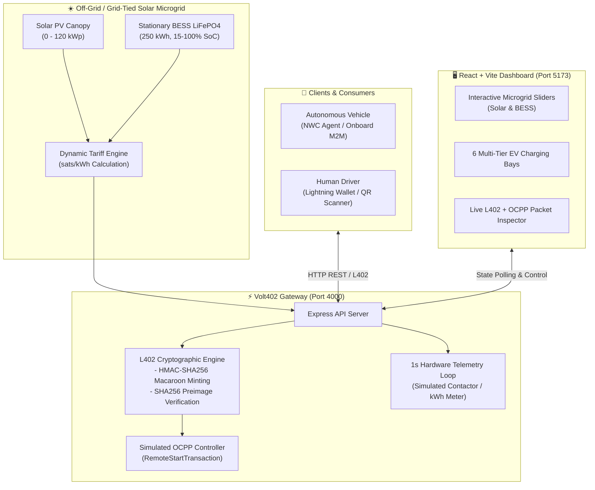
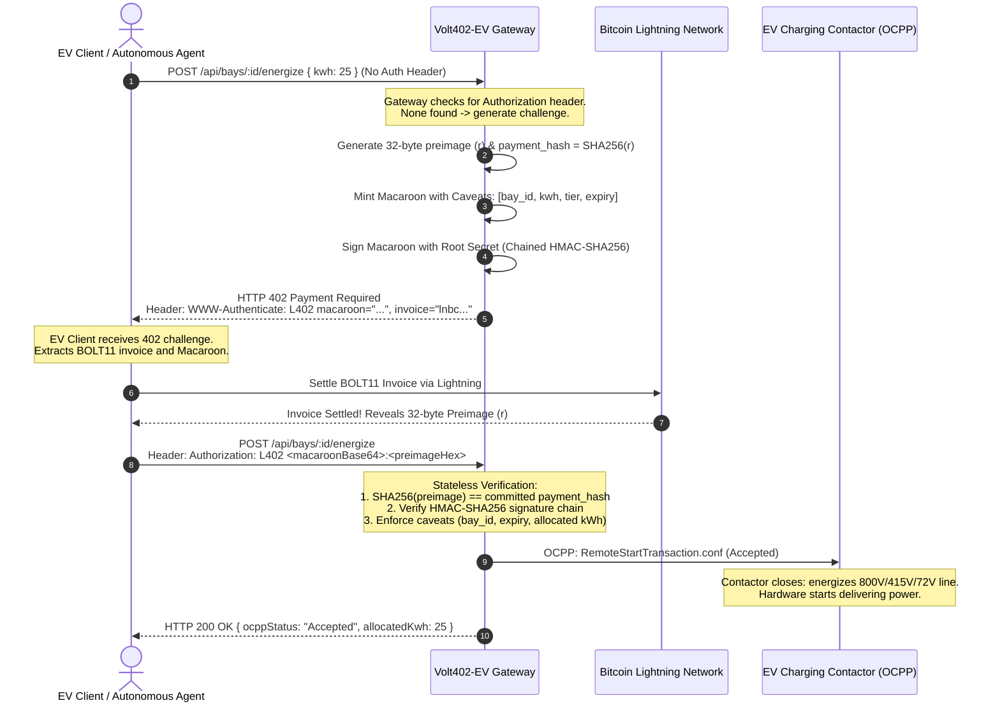

# ⚡ Volt402-EV

> **Autonomous Solar Supercharger & EV Charging Microgrid Digital Twin gated by Bitcoin Lightning Network (L402 Protocol) & simulated OCPP.**

[](https://www.typescriptlang.org/)
[](https://nodejs.org/)
[](https://react.dev/)
[](https://vitejs.dev/)
[](https://tailwindcss.com/)
[-f7931a.svg)](https://docs.lightning.engineering/the-lightning-network/l402)
[](https://openchargealliance.org/)

---

## 📖 Table of Contents

- [Overview](#-overview)
- [The Problem & The L402 Solution](#-the-problem--the-l402-solution)
- [System Architecture](#-system-architecture)
- [L402 Protocol & Payment Flow](#-l402-protocol--payment-flow)
- [Dynamic Microgrid Tariff Engine](#-dynamic-microgrid-tariff-engine)
- [EV Charging Bays & Fleet Matrix](#-ev-charging-bays--fleet-matrix)
- [Project Structure](#-project-structure)
- [API Reference](#-api-reference)
- [Getting Started](#-getting-started)
- [Under the Hood: Cryptography](#-under-the-hood-cryptography)
- [License](#-license)

---

## ⚡ Overview

**Volt402-EV** is an end-to-end digital twin of an off-grid / grid-tied solar electric vehicle supercharging microgrid. It bridges the gap between **energy hardware (OCPP charge points, solar PV, stationary battery storage)** and **programmable micro-transactions on the Bitcoin Lightning Network** via the open **L402 standard**.

Volt402-EV demonstrates both:
1. **Machine-to-Machine (M2M) Autonomous Plug & Charge**: Connected autonomous vehicles (e.g., robo-taxis, delivery vans, electric motorbikes) programmatically negotiate charging rates, pay for electricity per-kWh in real-time satoshis, and trigger contactor energization without human intervention.
2. **Human Driver QR Charging**: Drivers scan a BOLT11 invoice from their mobile Lightning wallet, settle the invoice, and automatically unlock charging without registering an account, installing a proprietary app, or swiping a credit card.

---

## 💡 The Problem & The L402 Solution

### Current EV Charging Pain Points
- **Walled Gardens**: Drivers must juggle dozens of proprietary apps (ChargePoint, EVgo, Electrify America, etc.).
- **Forced KYC & Accounts**: Mandatory account creation, email verification, and stored credit cards.
- **Card Skimming & Connectivity Issues**: Physical card readers on outdoor chargers are prone to hardware skimming and merchant processor dropouts.
- **No M2M Support**: Autonomous vehicles and robotic delivery fleets have no native way to pull up, pay, and charge without human credit cards.

### The L402 Paradigm
The **L402 Protocol** (formerly LSAT) pairs **HTTP 402 Payment Required** with **Macaroons** and **Lightning Network BOLT11 invoices**:
- **Zero Account Signups**: The token *is* the credential. Possession of the Macaroon + payment preimage proves entitlement.
- **Stateless Verification**: The charging gateway verifies authorization cryptographically without querying an authentication database.
- **Granular Caveats**: Macaroons embed strict limits: specific bay ID, max allocated kWh, station tier, and expiry timestamps.
- **Instant Finality**: Sub-second settlement via Lightning Network micro-payments.

---

## 🏗️ System Architecture



---

## 🔄 L402 Protocol & Payment Flow



---

## 📈 Dynamic Microgrid Tariff Engine

The cost of charging is dynamically calculated in real time using local renewable supply and storage demand:

$$\text{Tariff} = \text{BaseRate} \times \left( \frac{100}{\max(\text{BESS}_{\text{SoC}}, 15)} \right) \times \left( 1 + \frac{\text{ActiveLoad}}{\text{SolarIrradiance} + 15} \right)$$

- **Peak Sun & High BESS SoC**: Electricity drops to surplus discount rates (~100–150 sats/kWh).
- **Overcast / Night with Depleted BESS**: Tariff automatically surges (up to 400+ sats/kWh) to protect stationary reserve power.
- **Interactive Sliders**: The dashboard provides live sliders for Solar Canopy (0–120 kWp) and BESS SoC (15–100%) to test tariff elasticity live.

---

## 🚗 EV Charging Bays & Fleet Matrix

Volt402-EV simulates a diverse 6-bay charging station accommodating different vehicle classes and voltage standards:

| Bay | Designation | Tier | Connector | Voltage / Max Power | Simulated Vehicle Model |
| :---: | :--- | :--- | :--- | :---: | :--- |
| **01** | Supercharger DC | `DC_FAST_120KW` | CCS2 | 800V DC • 100 kW | Hyundai Ioniq 5 (77 kWh) |
| **02** | Autonomous Fleet DC | `DC_FAST_120KW` | NACS | 800V DC • 120 kW | Autonomous Robo-Van (100 kWh) |
| **03** | Fast AC Fleet | `AC_LEVEL2_22KW` | Type 2 (3-Phase) | 415V AC • 22 kW | Rivian Delivery EDV (70 kWh) |
| **04** | Commuter AC | `AC_LEVEL2_22KW` | Type 2 (3-Phase) | 415V AC • 22 kW | BYD Dolphin EV (60 kWh) |
| **05** | E-Moto Dock A | `EMOBILITY_3KW` | 72V DC Smart Plug | 72V DC • 3.3 kW | Spiro Electric Moto (4.5 kWh) |
| **06** | E-Cargo Keke Dock | `EMOBILITY_3KW` | 72V DC Smart Plug | 72V DC • 3.3 kW | Solar Electric Tricycle (7.2 kWh) |

Each bay features live:
- Vehicle Battery State of Charge (SoC %)
- Contactor output telemetry (Active kW draw vs Max kW rating)
- Metered L402 Macaroon quota progress (Delivered kWh / Allocated kWh)
- Automatic contactor trip (`COMPLETED`) upon reaching allocated energy quota

---

## 📁 Project Structure

```
volt402-ev/
├── Makefile                # Monorepo task runner (install, dev)
├── package.json            # Root workspace orchestrator (concurrently)
├── package-lock.json
├── .gitignore
├── README.md
├── gateway/                # Backend API & L402 Gateway (Port 4000)
│   ├── package.json
│   ├── tsconfig.json
│   └── src/
│       ├── l402.ts         # Macaroon minting, HMAC chaining & preimage verification
│       └── server.ts       # Express server, station state & 1s telemetry loop
└── dashboard/              # Frontend Digital Twin UI (Port 5173)
    ├── package.json
    ├── tsconfig.json
    ├── vite.config.ts
    ├── index.html
    └── src/
        ├── App.tsx         # Station dashboard, packet inspector, live controls
        └── main.tsx        # React root entrypoint
```

---

## 📡 API Reference

### 1. Station Telemetry
```http
GET /api/station
```
**Response (200 OK):**
```json
{
  "solarIrradianceKw": 85,
  "bessSocPercent": 82,
  "baseRateSatsPerKwh": 150,
  "activeLoadKw": 100,
  "netBessFlowKw": -15,
  "dynamicTariffSatsPerKwh": 182,
  "bays": [...]
}
```

### 2. Update Environment Telemetry
```http
POST /api/telemetry/environment
Content-Type: application/json

{
  "solarIrradianceKw": 100,
  "bessSocPercent": 90
}
```

### 3. Request L402 Challenge / Energize Bay Contactor
```http
POST /api/bays/:id/energize
Content-Type: application/json

{
  "kwh": 25,
  "authMode": "HUMAN_QR"
}
```

#### Without Authorization Header (Step 1):
**Response (402 Payment Required):**
```http
HTTP/1.1 402 Payment Required
WWW-Authenticate: L402 macaroon="eyJpZGVudGlmaWVyIj...", invoice="lnbc2500n1p..."
```
```json
{
  "status": 402,
  "message": "Payment Required: Settle BOLT11 Invoice to unlock L402 Macaroon",
  "bayId": 1,
  "requestedKwh": 25,
  "tariffSatsPerKwh": 182,
  "totalSats": 4550,
  "macaroon": "eyJpZGVudGlmaWVyIj...",
  "invoice": "lnbc2500n1p...",
  "caveats": [
    "bay_id=1",
    "allocated_kwh=25",
    "tier=DC_FAST_120KW",
    "amount_sats=4550",
    "expires=1793284900000"
  ],
  "demoPreimage": "c4d32a9..."
}
```

#### With Authorization Header (Step 2):
```http
POST /api/bays/:id/energize
Content-Type: application/json
Authorization: L402 <macaroonBase64>:<preimageHex>

{
  "kwh": 25,
  "authMode": "HUMAN_QR"
}
```
**Response (200 OK):**
```json
{
  "status": 200,
  "ocppAction": "RemoteStartTransaction.conf",
  "ocppStatus": "Accepted",
  "bayId": 1,
  "allocatedKwh": 25,
  "paymentHashVerified": "a7b8c9...",
  "message": "Contactor Closed: Delivering 100 kW (800V) to Hyundai Ioniq 5"
}
```

### 4. Reset / Disconnect Bay
```http
POST /api/bays/:id/reset
```

---

## 🚀 Getting Started

### Prerequisites
- **Node.js**: v18.0.0 or higher
- **npm**: v9.0.0 or higher
- **Git**

### Installation

Clone the repository and install all dependencies with a single command:

```bash
git clone https://github.com/JerryIdoko/volt402-ev.git
cd volt402-ev
make install
```

*(Alternatively: `npm install && cd gateway && npm install && cd ../dashboard && npm install`)*

### Running Development Servers

Start both the **Gateway** and **Dashboard** concurrently:

```bash
make dev
```

*(Alternatively: `npm run dev`)*

The services will be available at:
- 🖥️ **Dashboard**: [http://localhost:5173](http://localhost:5173)
- ⚡ **L402 Gateway**: [http://localhost:4000](http://localhost:4000)

---

## 🔐 Under the Hood: Cryptography

### 1. Macaroon Minting
Volt402-EV creates Macaroons using a chained HMAC-SHA256 signature scheme:
```typescript
let sig = HMAC_SHA256(ROOT_SECRET, identifier);
for (const caveat of caveats) {
  sig = HMAC_SHA256(sig, caveat);
}
```
Because HMAC is a one-way construction, clients can inspect caveats but cannot forge or tamper with any caveat without invalidating the cryptographic signature.

### 2. Preimage Verification (Proof of Payment)
In the Bitcoin Lightning Network, an invoice payment is completed when the payee reveals a 32-byte secret preimage $r$, where:

$$\text{PaymentHash} = \text{SHA-256}(r)$$

When the client passes `Authorization: L402 <macaroon>:<preimage>`, the gateway checks:
```typescript
crypto.createHash("sha256").update(preimage).digest("hex") === committedPaymentHash
```
This guarantees mathematical proof of settlement before the high-voltage EV contactor is energized.

---

## 📄 License

MIT License. Designed & Built for open-source Lightning Network & EV infrastructure innovation.

